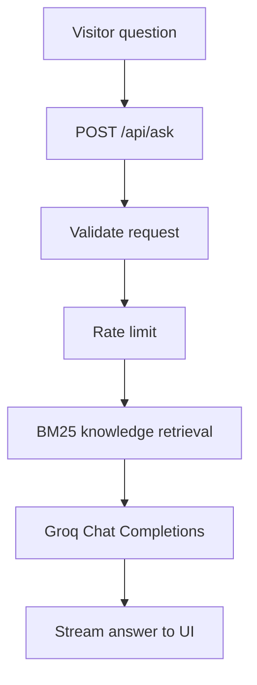

# Divyam Choudhary — AI Engineer

<p align="center">
  <a href="https://divyam-portfolio-teal.vercel.app/"><strong>🌐 View Live Portfolio</strong></a>
  &nbsp;·&nbsp;
  <a href="https://www.linkedin.com/in/divyamchoudharyy/">LinkedIn</a>
  &nbsp;·&nbsp;
  <a href="https://github.com/Divyamchoudharyy">GitHub</a>
</p>

<p align="center">
  <a href="https://github.com/Divyamchoudharyy/Portfolio/actions/workflows/ci.yml">
    
  </a>
  <a href="https://divyam-portfolio-teal.vercel.app/">
    
  </a>
  
  
  
</p>

A monochrome, responsive AI engineering portfolio featuring an interactive **ORBIT multi-agent architecture visualisation** and **DIVYAM.AI**, a Groq-powered assistant that answers questions about my background and work using curated portfolio knowledge.

> **Live website:** [divyam-portfolio-teal.vercel.app](https://divyam-portfolio-teal.vercel.app/)

---

## About

I'm a Computer Science undergraduate at **VIT Bhopal University** (2023–2027), with a CGPA of **8.44**. My current focus is **Agentic AI, multi-agent systems and LLM-powered applications**. I also have experience building and evaluating machine-learning systems and full-stack applications.

During my AI/ML internship at **GSIT Innovators Pvt. Ltd.** (Apr–Jun 2026), I worked on Python-based customer-support agents using the Google Gemini API, external API integrations, tool calling and response-handling logic.

## Featured work

### [ORBIT — Autonomous Deep Research Engine](https://github.com/Divyamchoudharyy/orbit-research-engine)

A supervisor-orchestrated research workflow built with **LangGraph**. Specialized Planner, Researcher, Critic and Writer agents plan research, retrieve information from Tavily, ArXiv and Wikipedia, review gaps, and produce structured reports with citations. The project includes an asynchronous FastAPI service, job tracking, Server-Sent Events (SSE), human-in-the-loop review and SQLite/PostgreSQL persistence.

**Project stack:** Python · LangGraph · LangChain · FastAPI · Groq · Tavily · ArXiv · Wikipedia · Streamlit · SQLite/PostgreSQL · LangSmith · Docker

### [Locust Watch — Desert Locust Outbreak Risk Predictor](https://github.com/Divyamchoudharyy/locust-watch)

An end-to-end ML application combining FAO swarm observations with TerraClimate environmental data. Users can select a location on an interactive map and inspect a risk indicator with contributing factors.

- **Live demo:** [locust-watch.netlify.app](https://locust-watch.netlify.app/)
- **Model evaluation:** 0.84 ROC-AUC with a random split versus 0.76 with spatial validation, exposing the impact of spatial leakage.
- **Recall:** approximately 79% at the selected operating point.

The model is a **2020-condition snapshot indicator, not a future forecast**.

**Stack:** Python · scikit-learn · FastAPI · React · Leaflet · xarray · TerraClimate

### [Drug Discovery AI — BBB Permeability Prediction](https://github.com/Divyamchoudharyy/drug-discovery-ai)

A blood-brain barrier permeability classifier using the MoleculeNet BBBP dataset, RDKit Morgan fingerprints and a Random Forest model.

- **Random split:** 0.936 ROC-AUC.
- **Scaffold split:** 0.884 ROC-AUC, a more demanding evaluation on unseen molecular scaffolds.

**Stack:** Python · RDKit · scikit-learn · Pandas · NumPy

---

## Portfolio assistant

**DIVYAM.AI** is a Groq-powered assistant embedded in the portfolio.

- Retrieves relevant facts from curated profile, experience and project notes using BM25.
- Streams generated answers to the browser.
- Handles contextual follow-up questions while prioritising the latest standalone question.
- Separates résumé-listed skills from tools documented in project repositories.
- Is instructed to say when information is unavailable rather than inventing credentials or results.

### Request flow



The Groq and Upstash credentials are read only by the server-side Vercel function. They are not exposed in frontend code.

## Technical toolkit

| Area | Technologies |
|---|---|
| Programming | Python, C++, JavaScript |
| Core CS | Data Structures & Algorithms, OOP, DBMS, SQL, Operating Systems, Computer Networks |
| Agentic AI / LLM project stack | LangGraph, LangChain, Groq, Tavily, LangSmith |
| LLM application development | Gemini API, tool calling, prompt engineering |
| Backend & web | FastAPI, REST APIs, React |
| Machine learning & data | scikit-learn, Pandas, NumPy, RDKit, xarray |
| Tools & infrastructure | Git/GitHub, Linux, Docker, Streamlit, SQLite, PostgreSQL, Vercel, Netlify, Render |

## Education & learning

- **B.Tech, Computer Science and Engineering** — VIT Bhopal University, 2023–2027 · CGPA: 8.44
- **Amazon ML Summer School 2025** — selected mentee; training in supervised and unsupervised learning, ensemble methods and regularisation.

## Run locally

**Requirements:** Node.js 22 or newer (Node.js 24.x recommended), npm, and a Vercel account/CLI to run the serverless AI endpoint locally.

1. Clone the repository and install dependencies:

   ```bash
   git clone https://github.com/Divyamchoudharyy/Portfolio.git
   cd Portfolio
   npm ci
   ```

2. Create a root-level `.env.local` file:

   ```env
   GROQ_API_KEY=your_groq_api_key
   GROQ_MODEL=openai/gpt-oss-120b
   ```

3. Run the Vercel API locally in Terminal 1:

   ```bash
   npx vercel dev --listen 3001
   ```

4. Run the Vite frontend in Terminal 2:

   ```bash
   npm run dev
   ```

5. Open the local Vite URL printed in Terminal 2 (normally `http://localhost:5173`). The Vite development proxy forwards `/api` requests to the Vercel function on port 3001.

For local-only visual work, `npm run dev` is sufficient, but the assistant requires the Vercel API process as well.

## Environment variables

| Variable | Purpose | Where to configure |
|---|---|---|
| `GROQ_API_KEY` | Server-side Groq API credential | Local `.env.local`; Vercel Preview/Production |
| `GROQ_MODEL` | Groq model identifier | `openai/gpt-oss-120b` |
| `UPSTASH_REDIS_REST_URL` | Shared production rate-limit storage | Vercel Preview/Production |
| `UPSTASH_REDIS_REST_TOKEN` | Upstash REST credential | Vercel Preview/Production |

For production and preview deployments, configure both Upstash variables to enable the shared rate limiter. The assistant is limited to **20 requests per IP per 10-minute window**. The limiter hashes the client IP before using it as the Redis key and fails closed in hosted environments if shared rate limiting is not configured.

Never commit `.env.local`, Groq keys or Upstash credentials. Do not prefix server secrets with `VITE_`.

## Quality checks

```bash
npm test
npm run build
npm run preview
```

GitHub Actions runs the automated tests and production build on pushes and pull requests to `main`.

## Deploy

The portfolio is deployed on Vercel:

**[https://divyam-portfolio-teal.vercel.app/](https://divyam-portfolio-teal.vercel.app/)**

For a new deployment, import this repository into Vercel with the Vite preset, set the build command to `npm run build`, and the output directory to `dist`. Configure the four server-side environment variables above in the appropriate Vercel environments, then redeploy after changing them.

---

<p align="center">
  <strong>Build thoughtfully. Engineer intelligently. Keep learning.</strong>
</p>
