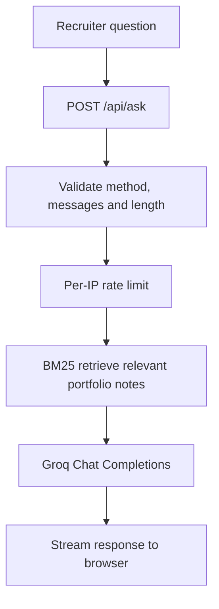

# Divyam Choudhary — AI Engineering Portfolio

[](https://github.com/Divyamchoudharyy/Portfolio/actions/workflows/ci.yml)

A monochrome, responsive portfolio built with React and Vite. ORBIT is the flagship project, supported by Locust Watch and Drug Discovery AI. The homepage includes an interactive ORBIT system map with keyboard-accessible agent focus states, and the site includes a Groq-powered portfolio assistant backed by BM25 retrieval over curated profile and project notes.

The assistant is deliberately grounded in verified portfolio information. It distinguishes résumé-listed skills from technologies documented in ORBIT, prioritizes the latest standalone question, and preserves previous context only for genuine follow-ups.

## Stack

- **Frontend:** React 19, Vite 6, CSS
- **AI assistant:** Groq Chat Completions API with streaming responses
- **Retrieval:** BM25 over curated portfolio knowledge
- **Backend:** Vercel Node.js Function (`api/ask.js`)
- **Production rate limiting:** Upstash Redis REST API (shared, atomic fixed-window counter)
- **Quality checks:** Node.js test runner and GitHub Actions (Node 24)
- **Security headers:** CSP, MIME sniffing protection, frame restrictions, referrer policy and permissions policy

## Run locally

Requirements: Node.js 22 or newer. Node.js 24.x is the recommended local and Vercel runtime for this release.

```bash
npm ci
npm run dev
```

This starts the visual portfolio through Vite. To test the AI serverless function as well, use `npx vercel dev` as described below.

## Configure environment variables

1. Create a Groq API key in the [Groq Console](https://console.groq.com/keys).
2. Copy `.env.example` to `.env.local` in the project root.
3. Add your Groq key to `.env.local`:

```env
GROQ_API_KEY=your_groq_api_key_here
GROQ_MODEL=openai/gpt-oss-120b
```

Do not add quotes around the values unless the value itself requires them. Keep `.env.local` private. It is ignored by Git. Never use a `VITE_` prefix for secrets and never place API keys in frontend code.

### Shared rate limiting for Vercel

The local development server uses a small in-memory limiter. That fallback is only for local testing; serverless instances do not share memory.

Before enabling the assistant on Vercel Preview or Production, create an [Upstash Redis database](https://console.upstash.com/) and add these server-side environment variables to the Vercel project:

```env
UPSTASH_REDIS_REST_URL=https://your-database.upstash.io
UPSTASH_REDIS_REST_TOKEN=your_upstash_rest_token
```

The endpoint enforces **20 assistant requests per IP per 10-minute window**. The IP identifier is hashed before it is stored in Redis. The limiter uses an atomic Redis Lua script through Upstash's REST API. If the shared limiter is not configured in a Vercel Preview or Production deployment, the endpoint fails closed instead of exposing an unmetered Groq endpoint.

Do not commit either Upstash value. Add them under Vercel → Project → Settings → Environment Variables for both Preview and Production. Redeploy after changing environment variables.

## Run the full app locally, including the AI API

Make sure `.env.local` contains `GROQ_API_KEY`, then run:

```bash
npx vercel dev
```

The local API uses the in-memory rate-limit fallback unless Upstash credentials are also supplied locally. The local fallback is not a production abuse-prevention mechanism.

## Test and build

```bash
npm test
npm run build
npm run preview
```

- `npm test` checks knowledge retrieval, contextual follow-ups, client IP extraction and local rate limiting.
- `npm run build` creates the production frontend in `dist/`.
- GitHub Actions runs the tests and production build on pushes and pull requests to `main`.

## Deploy to Vercel

1. Push the repository to GitHub and import it into Vercel.
2. Use the **Vite** framework preset.
3. Build command: `npm run build`.
4. Output directory: `dist`.
5. Add `GROQ_API_KEY` and (optionally) `GROQ_MODEL` to Vercel Environment Variables.
6. Add `UPSTASH_REDIS_REST_URL` and `UPSTASH_REDIS_REST_TOKEN` for Preview and Production before making the assistant public.
7. Redeploy after adding or changing environment variables.

Vercel detects `api/ask.js` as a Node.js Function. The Groq and Upstash credentials are only read server-side and are never sent to the browser.

## Assistant request flow



The assistant should state when a detail is not present in the supplied notes rather than inventing an achievement, metric or project capability. ORBIT is a portfolio project; do not imply commercial customer usage.

## Update portfolio content

- Profile links, email and location: `src/App.jsx` → `PROFILE`.
- Project descriptions, links and metrics: `src/App.jsx` → `projects`.
- Skill groups: `src/App.jsx` → `skillGroups`. Résumé-listed skills and the additional ORBIT project stack are intentionally separated.
- Assistant knowledge and retrieval: `api/ask.js` → `KNOWLEDGE` and `retrieve()`.
- Rate-limit settings: `api/ask.js` → `RATE_LIMIT` and `RATE_WINDOW_SECONDS`.

ORBIT is included as the flagship project independently of the current résumé PDF. Add it to the résumé once its project entry is updated.


See [`DEPLOY-TODAY.md`](./DEPLOY-TODAY.md) for the final launch checklist, environment-variable matrix and smoke tests.
